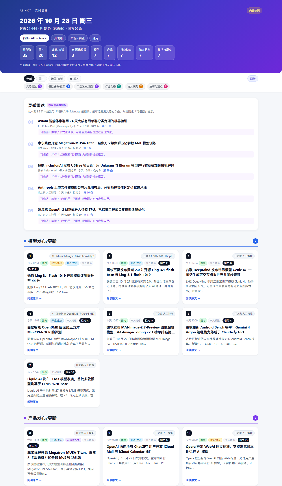
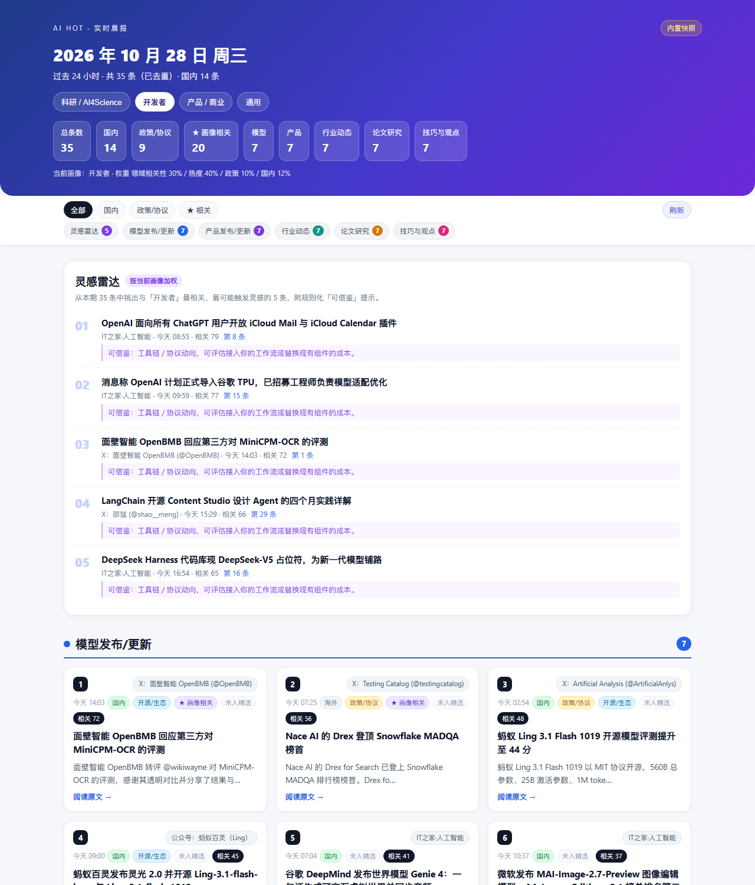
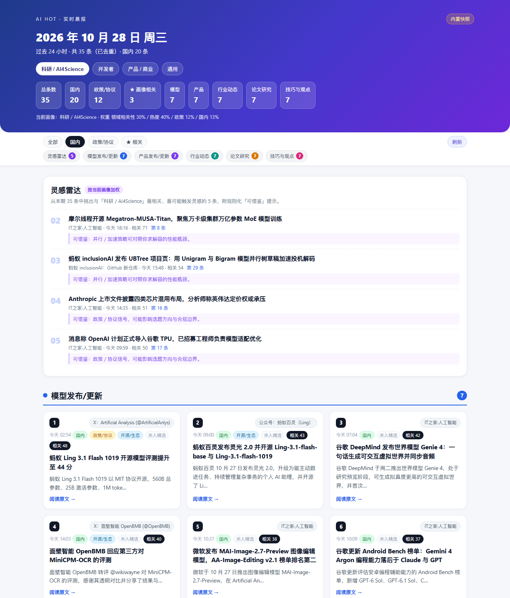

# AI_news · 实时个性化 AI 资讯雷达

把每天上百条 AI 新闻，按你的关注画像重排成一份能直接读的晚报。

线上地址（索引页）：<https://cotigo-cmd.github.io/AI_news/>
实时版：<https://cotigo-cmd.github.io/AI_news/live.html>



## 为什么做

AI 资讯的问题不是「太少」，而是「和你无关的太多」：海外技术动态占绝对多数，按时间或热度排序，学生和研究者很难在十分钟内找到与自己课题相关的信号。

打开这个页面，它会从 AI HOT 公开接口拉取近 24 小时数据，按五个版块组织，并用四套「关注画像」对同一条新闻给出不同排序。

**定位**：AIHOT 负责采集与编辑；本页负责按你的方向重排、去重、给灵感。

## 功能

- **四画像切换**：前沿理论、开发者、产品商业、通用。同一批新闻，换画像整页重排。
- **画像加权**：前沿理论 / 国内生态 / 政策 > 热度，而不是单纯按时间。
- **事件去重**：重叠系数 + 共享专名；同一事件全站最多保留 2 条。
- **灵感雷达**：挑出最相关的前 5 条，附规则化「可借鉴」提示，把新闻变成选题线索。
- **站内详情抽屉**：完整摘要、可借鉴、同主题、稍后读；先留在站内，原文 / AIHOT 作为二级入口。
- **点击学习**：按你点开的类别与标签，用平滑 CTR 给后续排序做小幅加权；本地存储、可关闭、可重置。
- **过滤**：全部 / 国内 / 政策协议 / 画像相关 / 稍后读。
- **纯前端**：浏览器直连公开 API（CORS `*`），无后端、无登录。
- **离线兜底**：接口不可用时自动切内置快照，不白屏。
- **响应式**：320px 起可用。

## 结构

```
index.html                  索引页：实时入口 + 日报/周报归档
live.html                   实时版（自包含，内嵌离线兜底）
archive/daily/*.html        日报归档（按日期）
archive/weekly/*.html       周报归档（按日期）
archive_index_template.html 索引页模板
build_archive_index.py      扫描 archive/ 生成 index.html
live_template.html          实时版前端模板（含 __FALLBACK__ 占位符）
build_live_app.py           注入当日兜底数据，生成 live.html
gen_briefing.py             本地晚报 / 周报生成器 + 定时任务
screenshots/                桌面与移动端截图
.nojekyll                   关闭 Jekyll，静态文件原样发布
```

## 本地运行

```bash
python -m http.server 8000
```

打开 <http://localhost:8000> 是索引页，实时版在 <http://localhost:8000/live.html>。

重新生成实时版兜底快照（需要联网拉取 AI HOT）：

```bash
python build_live_app.py live.html
```

新增往期归档后，重新生成索引页：

```bash
python build_archive_index.py
```

## 可分享的视图

实时版（`live.html`）支持：

| 参数 | 作用 |
| --- | --- |
| `?profile=research\|dev\|business\|general` | 指定关注画像 |
| `?filter=all\|dom\|pol\|rel\|saved` | 指定过滤条件（saved 需先在本机加入稍后读） |
| `?snapshot=1` | 强制使用内置快照（离线演示） |

## 点击学习怎么算

- 展示时记一次曝光（同一会话同一标题只记一次）；点开卡片记一次点击。
- 类别与标签分别算平滑 CTR：`(点击 + 0.5) / (曝光 + 5)`。
- 排序加分 = `15 × (0.6 × 类别 CTR + 0.4 × 标签 CTR)`，最多 +15 分。
- 只存浏览器 `localStorage`，不上传；可一键关闭或重置。

## 数据与边界

- 数据源：AI HOT 公开接口 `https://aihot.virxact.com/api/v1`，匿名只读。
- 标题与摘要版权归原作者；引用数字 / 政策请以原文为准。
- 排序为本地画像加权结果，不代表 AI HOT 官方排序。
- 未进入 AI HOT 精选的公开条目会在卡片上标注「未入精选」。

## 截图

| 画像切换 | 只看国内 |
| --- | --- |
|  |  |

移动端：`screenshots/04_mobile.png`

## 部署

推送到 `main` 后 GitHub Pages 自动发布，通常 30 秒内生效。

## 备注

本项目为 WorkBuddy「1024 造物挑战」参赛作品。
